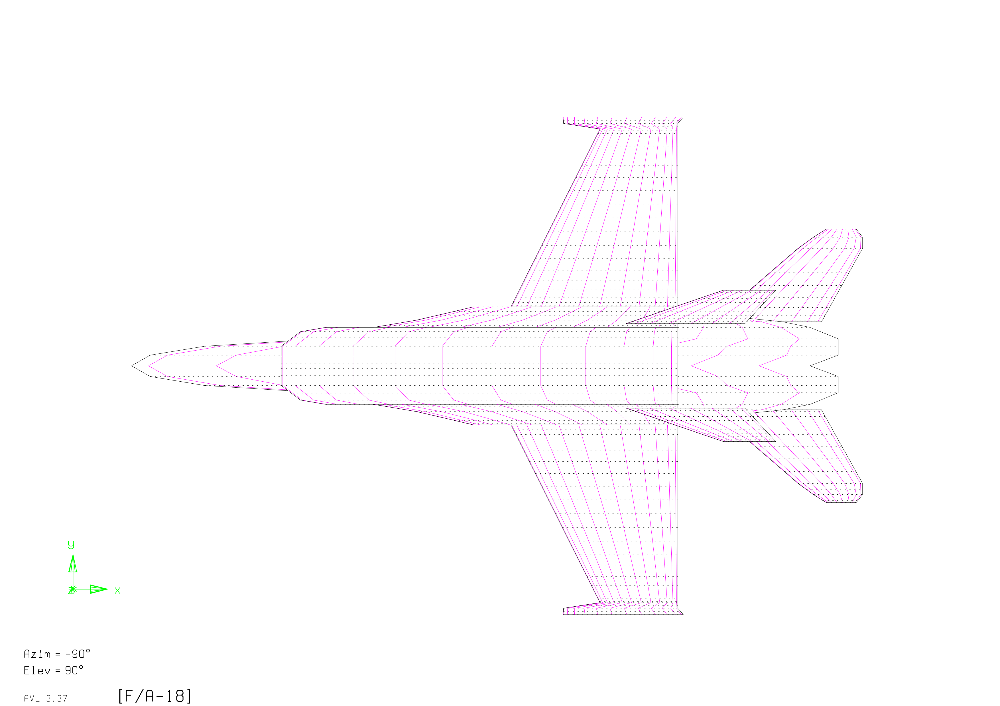
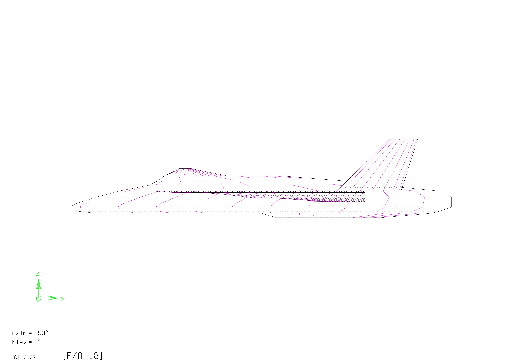
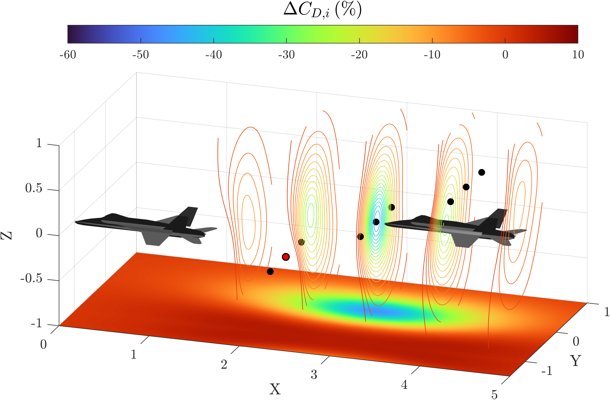
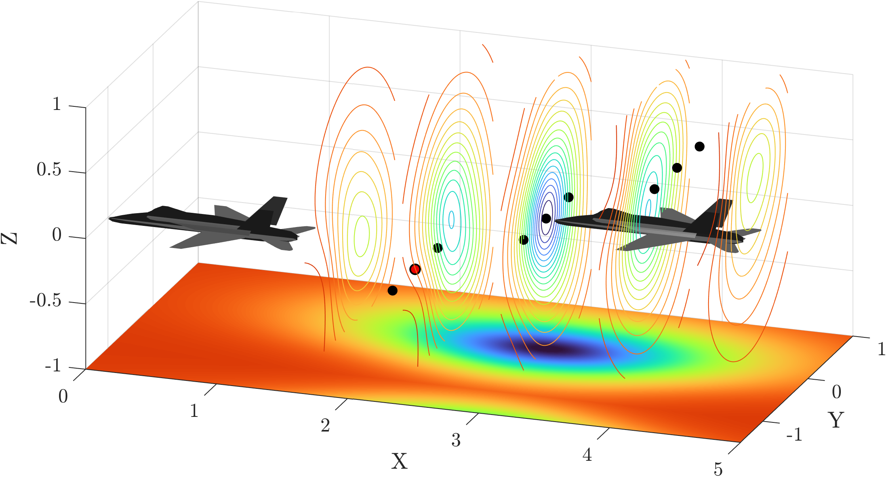
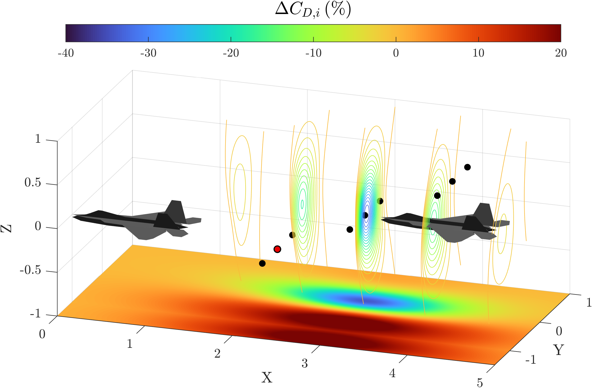
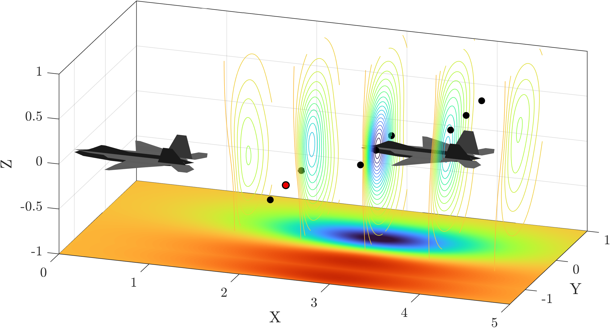
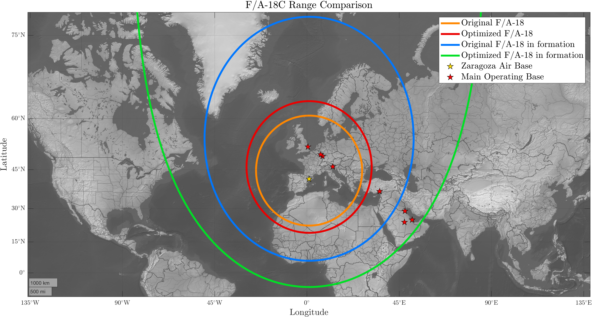
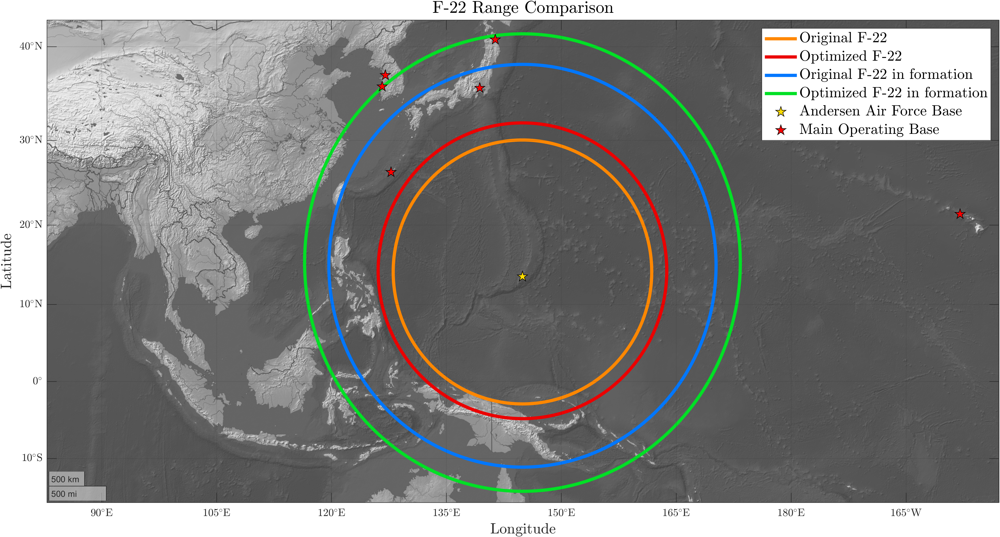

## The problem: formation flight

Formation flight enables **aerodynamic drag reduction** by exploiting the interaction between aircraft wakes. A trailing aircraft positioned within the **upwash region of a wingtip vortex** requires less lift to sustain flight, resulting in reduced thrust demand.

Both experimental and theoretical studies demonstrate that this mechanism can significantly decrease **induced drag** and **fuel consumption**, particularly in **subsonic cruise conditions**, where induced drag is a dominant contribution.

However, for fighter aircraft—characterized by **low aspect ratio** and **swept wings**—the effectiveness of formation flight remains less understood and strongly dependent on:

- **aircraft geometry**
- **relative positioning** within the formation
- **wake interaction structure**

### Objective

This project evaluates how different fighter aircraft configurations benefit from formation flight, and whether **aerodynamic optimization** can enhance these effects.

The analysis is structured into three main stages:

- **Comparative analysis** across multiple aircraft generations
- **Wing planform optimization** for selected configurations
- **Assessment of optimal relative positioning** within the formation

The ultimate goal is to quantify improvements in **drag reduction**, **aerodynamic efficiency**, and **operational range**.

 

**Figure 1:** Aircraft geometries reconstructed from three-view drawings and implemented in **AVL** for aerodynamic analysis.  
**Image Credit:** Marco Zappoli

## Key findings

### 1. Drag reduction is significant, but configuration-dependent

Trailing aircraft experience substantial reductions in induced drag, typically in the range of **20–60%**, depending on geometry and spacing.

In contrast, the leading aircraft shows negligible benefits or slight penalties. The results highlight that **aerodynamic gains are highly configuration-dependent**.

### 2. Relative positioning is critical

Maximum benefit is achieved when aircraft are positioned such that their **wingtip vortices interact constructively**, typically with aligned wingtips.

Even small deviations from the optimal configuration lead to a rapid loss of benefit, making formation flight a **highly sensitive aerodynamic condition**.

### 3. Optimization enhances robustness and performance

Wing optimization, performed using **particle swarm algorithms**, produces non-intuitive geometries that improve overall **lift-to-drag performance**.

Optimized configurations:

- increase drag reduction for trailing aircraft
- reduce sensitivity to positioning errors
- expand the region of beneficial wake interaction

Baseline Optimized  

McDonnell Douglas F/A-18C

Baseline Optimized  

McDonnell Douglas F-22A

**Figure 2:** Comparison between **baseline** and **optimized configurations**. The quantity $\Delta C_{D,i}$ represents the variation in induced drag coefficient of the trailing aircraft relative to isolated flight. Contour regions indicate $\Delta C_{D,i} < 0$, corresponding to beneficial wake interaction. The floor projection shows the X–Y distribution at optimal vertical positioning. Black markers denote sampled configurations (Latin Hypercube Sampling), while the red marker identifies the reference case.  
**Image credit:** Marco Zappoli

### 4. Impact on operational range

The reduction in drag directly translates into an increase in **mission range**.

Using the **Breguet range equation**, the study shows that:

- two-aircraft formations significantly extend ferry range
- aerodynamic optimization further amplifies this effect
- some missions become feasible without **aerial refueling**

 

**Figure 3:** Ferry range comparison for the **F-22A** (left) and **F/A-18C** (right). Range contours are computed using the Breguet equation under cruise conditions ($M=0.56$, 25,000 ft), assuming dry thrust-specific fuel consumption and a 20% fuel reserve. “Formation” denotes conditions where the trailing aircraft benefits from wake-induced drag reduction.  
**Image credit:** Marco Zappoli

## Key Takeaways

Formation flight is a **powerful yet highly sensitive mechanism** for improving aerodynamic efficiency.

Its effectiveness depends on a delicate balance between:

- **aircraft design**
- **relative positioning**
- **wake interaction dynamics**

Coupling formation flight with **aerodynamic optimization** provides a promising pathway to **extend range**, **reduce fuel consumption**, and **enhance mission flexibility**.

## Technical report

The complete report provides a detailed description of the **methodology**, **modeling assumptions**, and **validation analyses** supporting this work.

[View or download the full technical report (PDF)](/pdf/Report_Progetto_Aerodinamico.pdf)
