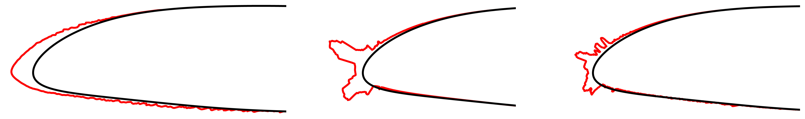
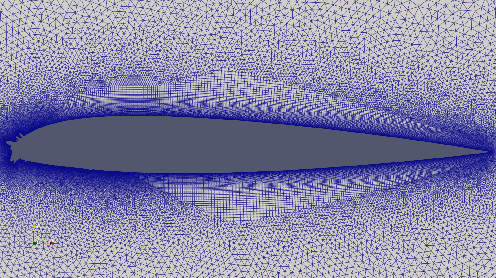
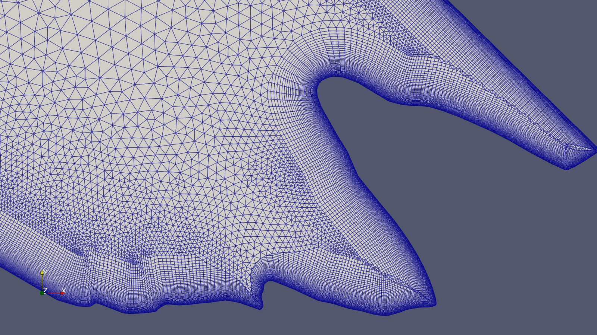
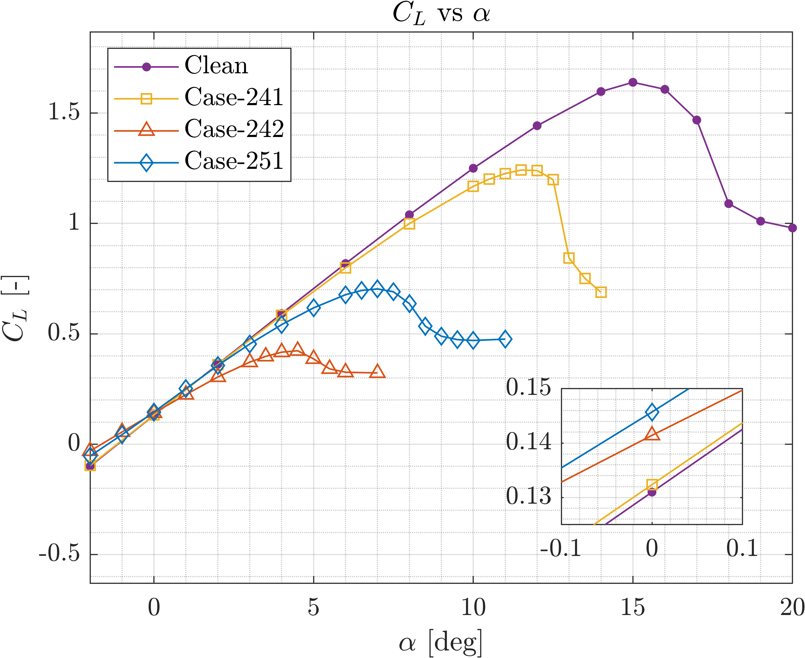
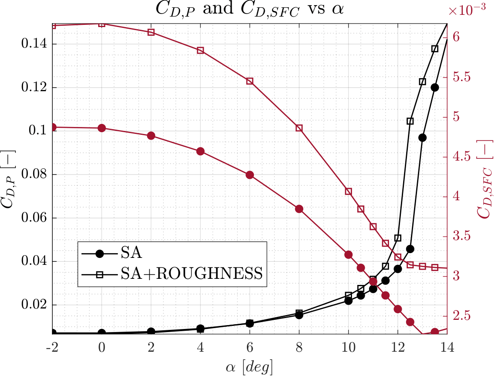

## The problem: ice accretion on airfoil

This project investigates the aerodynamic consequences of **ice accretion** on the NACA 23012 airfoil through high-fidelity **Computational Fluid Dynamics (CFD)** simulations. Ice formation alters the airfoil geometry, particularly at the **leading edge**, introducing complex flow phenomena that lead to a significant degradation in aerodynamic performance.

**Figure 1:** Comparison of the investigated iced geometries: **Case-241** (left), **Case-242** (center), and **Case-251** (right). These configurations represent different ice accretion regimes with increasing geometric complexity.  
**Image Credit:** Marco Zappoli

The study focuses on quantifying variations in **lift**, **drag**, and **pitching moment** across multiple iced configurations, representative of both **rime** and **glaze ice** conditions.

## Methodology

The analysis was performed using **steady, compressible RANS simulations** with the **SU2 solver**, under representative flight conditions ($M=0.325$, $Re=3.8 \cdot 10^6$).

A **hybrid meshing strategy** was adopted to ensure accurate boundary layer resolution ($y^+ \approx 1$), combining structured layers near the wall with unstructured elements in the far field. Mesh generation was carried out using **Gmsh** and **Pointwise**, alongside the development of a **custom MATLAB-based workflow** to handle the complexity of iced geometries.

 

**Figure 2:** Mesh generation for complex iced geometries. Left: boundary layer resolution using the **T-Rex anisotropic extrusion** algorithm. Right: detailed view highlighting mesh quality in regions of strong geometric irregularity.  
**Image Credit:** Marco Zappoli

Two turbulence models were considered:

- **Spalart–Allmaras (SA)**
- **$k-\omega$ SST**

**Grid convergence studies** were performed to assess numerical reliability. The computational setup was validated against experimental wind tunnel data, confirming the robustness of the adopted methodology.

## Results

Ice accretion leads to a **substantial degradation of aerodynamic performance**, with severity strongly dependent on ice morphology:

- **Rime ice (Case-241):** Moderate impact, primarily increasing the effective chord and inducing localized separation.  
  $\rightarrow$ Stall angle reduced from $\approx 15^\circ$ to $\approx 12^\circ$.
- **Glaze ice (Case-242, Case-251):** Severe degradation due to **horn-shaped leading-edge formations**.
  - Stall angle reduced below $5^\circ$ (Case-242)
  - Significant decrease in **lift slope** and increase in **drag**
  - Early onset of **large-scale separation** and **recirculation**

Surface roughness further amplifies drag, with **skin friction contributions increasing by ~30%**, highlighting the combined effect of geometry and near-wall turbulence.

 

**Figure 3:** Left: comparison of lift curves for all configurations using the SA turbulence model. Right: decomposition of drag into **pressure** ($C_{D,P}$) and **skin-friction** ($C_{D,SFC}$) components for Case-241, with and without surface roughness.  
**Image credit:** Marco Zappoli

## Key Takeaways

- **Ice accretion alters boundary layer physics**, promoting early separation and forced transition.
- **Glaze ice** produces the most critical degradation due to strong geometric discontinuities.
- The **aerodynamic center shifts toward the leading edge**, affecting pitching moment and longitudinal stability.
- **Turbulence modeling choices** significantly influence predictions in separated flow regimes.

Overall, the results demonstrate how ice accretion leads to **reduced lift capability**, **increased drag**, and **altered stability characteristics**, emphasizing the importance of accurate CFD modeling for aeronautical safety applications.

## Technical report

The complete report provides a detailed description of the **methodology**, **modeling assumptions**, and **validation analyses** supporting this work.

[View or download the full technical report (PDF)](/pdf/CFD_Project.pdf)
