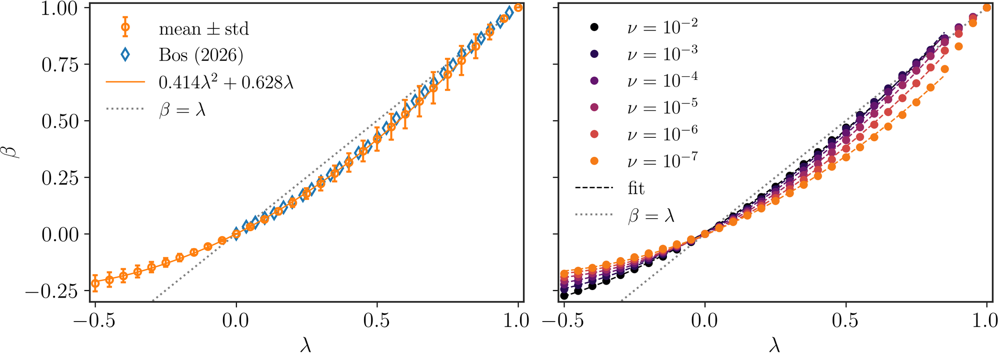
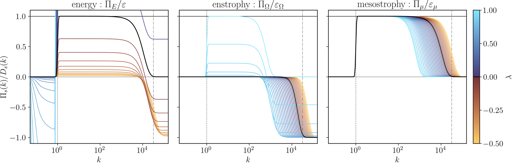
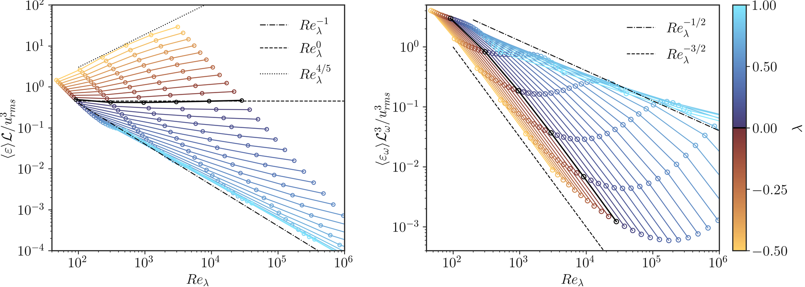

## Why remove vortex stretching?

Vortex stretching is the mechanism that, in three dimensions, carries energy from large to small scales and produces enstrophy. A clean way to measure how much the energy cascade depends on it is to **remove it gradually** and watch what changes. Bos (2026, *Phys. Rev. Fluids* **11**, 074605) introduced a family of models that does exactly this, controlled by a single parameter $\lambda$:

| $\lambda$ | model |
|---|---|
| $\lambda = 0$ | Navier–Stokes |
| $0 < \lambda < 1$ | vortex stretching partly removed |
| $\lambda = 1$ | no vortex stretching: enstrophy is conserved by the nonlinear transfer, as in 2D |
| $\lambda < 0$ | vortex stretching enhanced (extrapolation of the model) |

I wrote an **EDQNM closure** of this model, so that the whole $(\nu, \lambda)$ plane can be explored at Reynolds numbers far beyond direct numerical simulation.

## The model in short

For isotropic turbulence the energy spectrum obeys

$$
\frac{\partial E(k,t)}{\partial t} = T(k,t) - 2\nu k^2 E(k,t) + P(k),
$$

with a constant forcing spectrum $P(k)$. In EDQNM the nonlinear transfer $T(k)$ is an integral over all triads $\mathbf{k}+\mathbf{p}+\mathbf{q}=0$, weighted by a triad relaxation time and by shape factors that, in this model, depend on $\lambda$.

For $0 < \lambda < 1$ the transfer conserves neither energy nor enstrophy, but an intermediate quantity, the **mesostrophy** $\mu = \int k^{2\beta}E\,dk$, with an exponent $\beta(\lambda)$ that goes from 0 (energy) to 1 (enstrophy). A constant-flux mesostrophy cascade predicts the inertial range

$$
E(k) \propto \varepsilon_\mu^{2/3}\,k^{-(5+4\beta)/3},
$$

which is $k^{-5/3}$ at $\beta = 0$ and $k^{-3}$ at $\beta = 1$.

## Numerics

- **Grid:** logarithmic wavenumber grid with about 200 points, from $0.05\,k_f$ to $5\,k_\eta$.
- **Triads:** only the grid triads that can close a triangle are stored (about 5 % of all combinations); the transfer is one pass over this list, compiled with **Numba**.
- **Conservation:** exact to round-off, triad by triad: energy at $\lambda = 0$, enstrophy at $\lambda = 1$.
- **Time stepping:** low-storage RK3 for transfer and forcing, Crank–Nicolson for viscosity, with a time step limited by the stiffness of the transfer (spectral radius estimated by power iteration). Runs stop automatically at steady state.
- **Sweep:** a resumable driver over $\nu = 10^{-2}\dots10^{-8}$ and $\lambda = -0.5\dots1$, one process per run.

## Validation: the mesostrophy exponent

The exponent $\beta$ is measured in two independent ways: from the condition that the transfer conserves mesostrophy, $\int k^{2\beta}T\,dk = 0$, and from the balance between mesostrophy injection and dissipation. The two estimates agree to $O(10^{-4})$, and the result matches Bos (2026) over $0 \le \lambda \le 1$.

Left: $\beta(\lambda)$, mean and standard deviation over the viscosities, against Bos (2026). Right: each viscosity separately.

## Spectra and fluxes

The figure at the top of the page shows the steady energy spectra at $\nu = 10^{-6}$, coloured by $\lambda$ (black: Navier–Stokes); the bottom panels zoom on the scales larger than the forcing (left) and on the inertial and dissipation range (right).

As $\lambda$ increases the inertial range steepens continuously from $k^{-5/3}$ to $k^{-3}$, and the dissipation range moves to larger scales. With the forward energy cascade suppressed, energy piles up at scales larger than the forcing.

Fluxes of energy, enstrophy and mesostrophy, each divided by its own dissipation ($\nu = 10^{-6}$).

The fluxes are the clearest check of the conservation properties: the energy flux has a plateau only at $\lambda = 0$, the enstrophy flux only at $\lambda = 1$, while the **mesostrophy flux has a plateau for every $\lambda$**. Mesostrophy is the quantity that cascades at constant flux.

## Dissipative anomalies

Normalised energy dissipation (left) and enstrophy dissipation (right) against the Taylor Reynolds number $Re_\lambda$.

At $\lambda = 0$ the normalised energy dissipation tends to a constant, the classical dissipative anomaly. Without vortex stretching it decays with Reynolds number instead, in line with recent DNS (Chiarini, 2026). The closure reaches $Re_\lambda$ up to $10^6$, which makes these trends visible over several decades.

> [!WARNING] Ongoing work
> This code supports research in progress. The page describes the method and its validation; quantitative results are not reported here until they are published.
