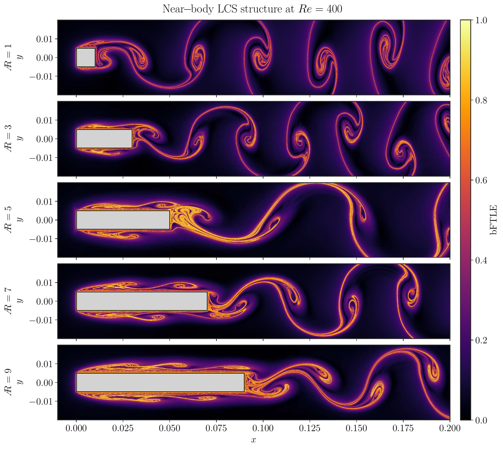
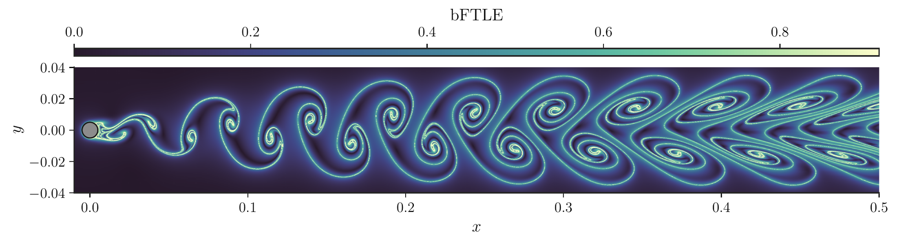
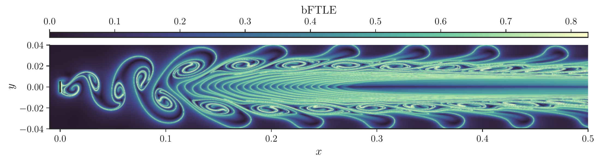
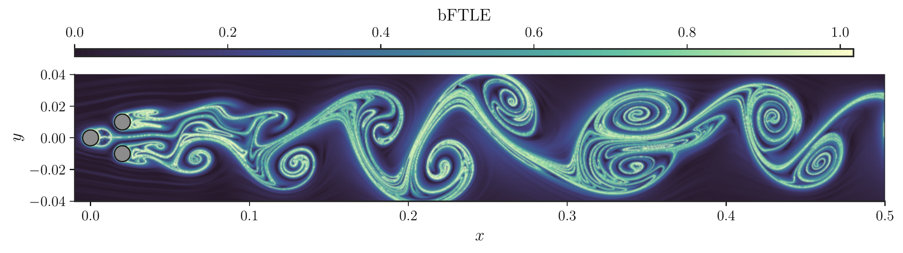
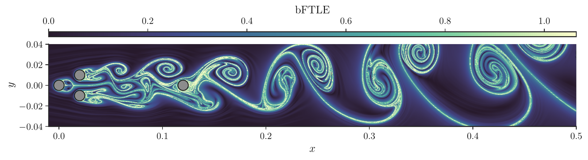

## Why Lagrangian coherent structures?

Snapshots of vorticity show where the flow rotates, but not how fluid is actually transported. **Lagrangian coherent structures** (LCS) are the material lines that organise transport in an unsteady flow: fluid and inertial particles are drawn towards some of them and pushed away from others.

A practical way to find them is the **finite-time Lyapunov exponent**. For the flow map $\mathbf{F}_{t_0}^{T}$ that takes a tracer from $\mathbf{x}_0$ at time $t_0$ to its position at $t_0+T$,

$$
\sigma_{t_0}^{T}(\mathbf{x}_0) = \frac{1}{|T|}\,\ln \sqrt{\lambda_{\max}\!\left(\mathbf{C}_{t_0}^{T}\right)},
\qquad
\mathbf{C}_{t_0}^{T} = \left(\nabla \mathbf{F}_{t_0}^{T}\right)^{\!\top} \nabla \mathbf{F}_{t_0}^{T}.
$$

Ridges of $\sigma$ mark the lines of strongest separation. Integrating **backward in time** ($T<0$) turns them into **attracting** structures: the lines along which tracers and heavy particles gather, which links this work to the particle clustering of my [thesis project](/projects/dns-particles-shear-turbulence/).

## Pipeline

1. **Flow fields.** Unsteady two-dimensional wakes simulated in **SU2** and saved as a time series of snapshots on the unstructured mesh.
2. **Resampling.** Each snapshot is interpolated onto a uniform Cartesian grid. The obstacle is masked automatically from the points that fall outside the mesh, so the same script works for any body shape.
3. **Far field.** Tracers that leave the CFD box during the integration continue in a uniform far-field velocity detected at the inlet, with the box padded upstream by the distance they can travel.
4. **Flow map and FTLE.** A dense grid of tracers is advected backward in time through the interpolated velocity field; the flow-map gradient gives the Cauchy–Green tensor and the FTLE.

> [!NOTE] Settings
> **Rectangular cylinders, $Re = 400$:** FTLE with **NumbaCS**, backward integration over $T = -10$ from the end of the simulation, snapshots resampled every $\Delta t = 0.01$ on a base grid of spacing $3\times10^{-4}$, and a tracer grid of $5000 \times 1785$ points in the near wake.
>
> **Circular cylinder, flat plate, pinball, $Re = 120$:** FTLE with a custom Python LCS toolkit that handles the mesh interrogation, interpolation in space and time, tracers that leave the domain and solid walls. Backward integration over 6.5 time units from $t_0 = 18$, with 70 snapshots resampled on a $601 \times 201$ grid.

## Rectangular cylinders at Re = 400

The animation at the top shows the backward FTLE around a rectangular cylinder of aspect ratio $AR = 9$: the shear layers separate at the leading edge, roll up along the sides and merge into the wake at the trailing edge.

Backward FTLE in the near wake of rectangular cylinders with $AR = 1, 3, 5, 7, 9$ at $Re = 400$.

Changing the aspect ratio changes where the structures form. On short bodies the shear layers roll up directly in the wake, while on longer ones they reattach and shed along the sides before reaching the trailing edge, and the downstream wake changes with them.

## Cylinders, plate and pinball at Re = 120

Backward FTLE at $Re = 120$, top to bottom: (a) circular cylinder, (b) flat plate normal to the flow, (c) fluidic pinball (three cylinders on an equilateral triangle), (d) fluidic pinball with a fourth cylinder downstream.

The circular cylinder gives the classical picture: each shed vortex is wrapped by attracting lines that spiral into its core, in the staggered pattern of the von Kármán street. The plate and the pinball produce richer wakes, and adding a downstream cylinder to the pinball reorganises the structures behind it.
