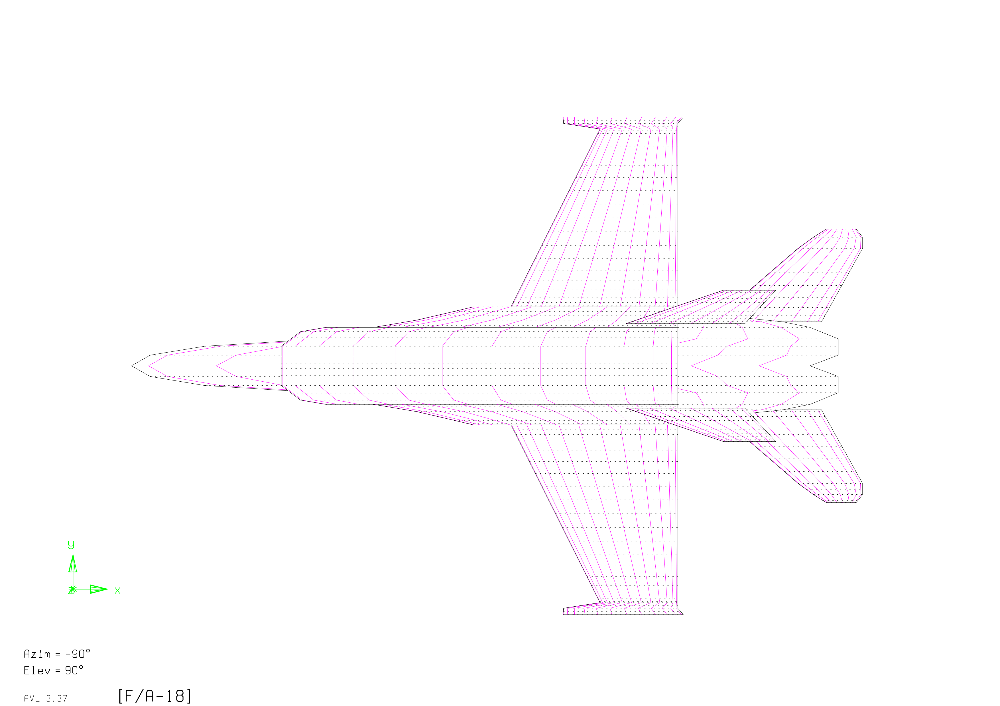
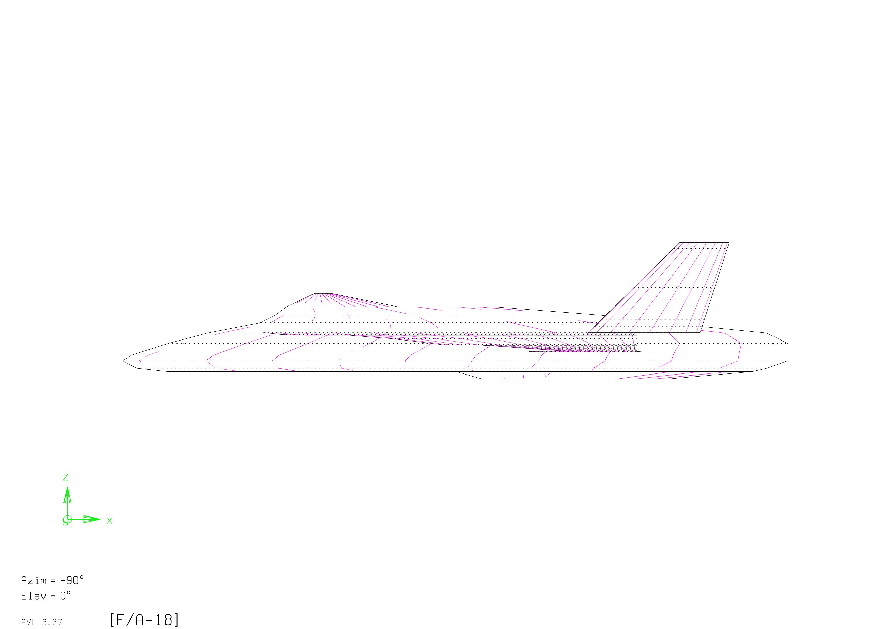
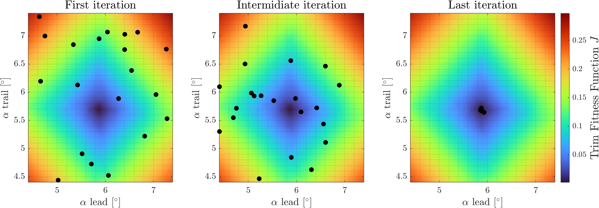
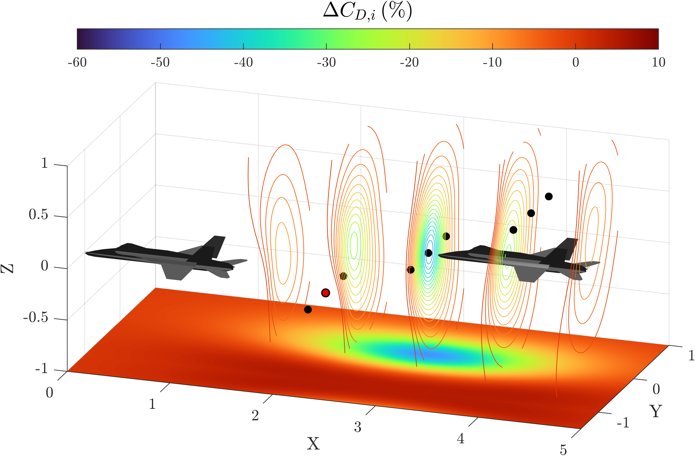
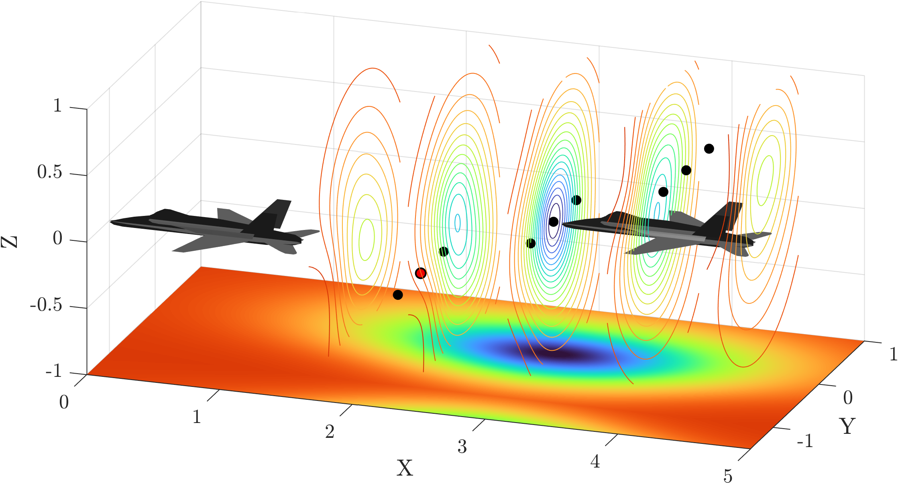
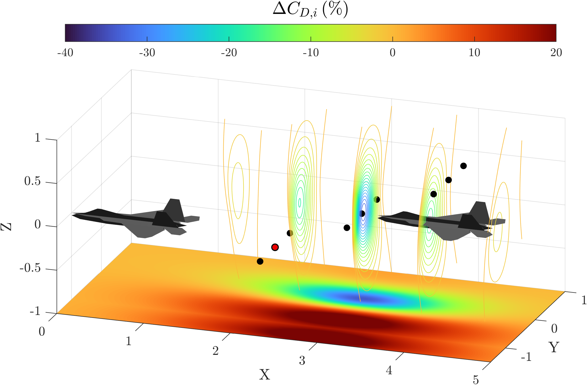
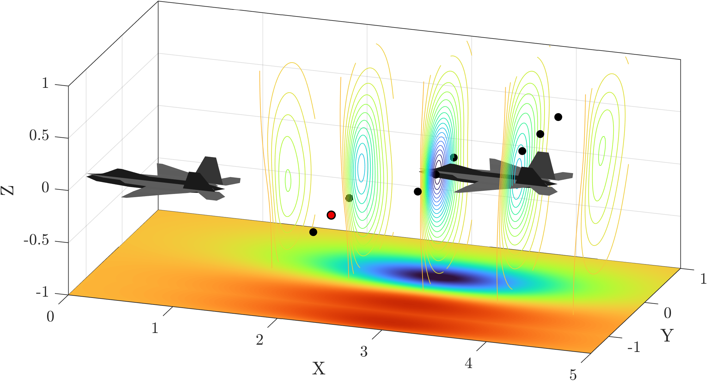
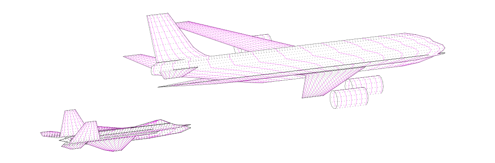

## The problem: formation flight

Formation flight enables **aerodynamic drag reduction** by exploiting the interaction between aircraft wakes. A trailing aircraft positioned within the **upwash region of a wingtip vortex** requires less lift to sustain flight, resulting in reduced thrust demand.

Both experimental and theoretical studies demonstrate that this mechanism can significantly decrease **induced drag** and **fuel consumption**, particularly in **subsonic cruise conditions**, where induced drag is a dominant contribution. NASA's Autonomous Formation Flight (AFF) programme measured it in flight on a pair of F/A-18s.

However, for fighter aircraft, characterized by **low aspect ratio** and **swept wings**, the effectiveness of formation flight remains less understood and strongly dependent on:

- **aircraft geometry**
- **relative positioning** within the formation
- **wake interaction structure**

### Objective

This project, carried out with Federico Poleni and Giacomo Visconti, evaluates how different fighter aircraft configurations benefit from two-ship formation flight, and whether **aerodynamic optimization** can enhance these effects. It is deliberately low-fidelity: one vortex-lattice evaluation takes seconds, so thousands of geometries and positions can be explored.

The analysis is structured into four stages:

1. **Comparative analysis** of twelve fighters across several generations, from the Aermacchi MB-339A to the F-22A Raptor
2. **Wing planform optimization** for three selected aircraft: Fiat G.91R, F/A-18C Hornet and F-22A Raptor
3. **Optimal relative positioning** of the trailing aircraft within the formation
4. **Mission impact**: aerial refueling behind a KC-135R and ferry-range extension

## Method

### Geometry and aerodynamic model

Each aircraft was rebuilt from public three-view drawings, rescaled against known span, length and wing area, and encoded as an input file for **AVL**, a vortex-lattice code. Lifting surfaces and their wakes are modelled as sheets of horseshoe vortices, with a Prandtl–Glauert correction for subsonic compressibility. All cases are trimmed at the same cruise point, $M = 0.56$ at 25,000 ft.

 

**Figure 1:** Aircraft geometries reconstructed from three-view drawings and implemented in **AVL** for aerodynamic analysis.  
**Image Credit:** Marco Zappoli

Trimming a formation means finding the angles of attack of the leader and the trailer together. This was itself solved as a small optimization problem with a particle swarm.

**Figure 2:** Particle swarm converging to the trim angles of attack of an F/A-18 formation: first, intermediate and last iteration. Colours show the trim cost function.  
**Image Credit:** FOSSER report

### Wing optimization

A MATLAB driver generates candidate wings, writes the AVL input, runs it and reads the coefficients back. The objective is the **lift-to-induced-drag ratio** $\eta = C_L / C_{D,i}$, maximised as

$$
J = -\eta + \sum_i \lambda_i P_i ,
$$

where the penalty terms $P_i$ rule out unrealistic wings: large changes in area, abrupt jumps in chord, sweep or dihedral, reverse taper, or shapes too far from the baseline. Particle swarm optimization (PSO) and a genetic algorithm were benchmarked on parallel MATLAB workers, and PSO was kept for its lower cost.

### Formation positioning

Each evaluation of a formation needs a new trim, so the position of the trailer was sampled with a **Latin hypercube** in $(\Delta X, \Delta Y, \Delta Z)$ and extended to the whole space with a **Kriging** (Gaussian-process) surrogate with a Matérn 5/2 kernel.

### Range

AVL gives only induced drag. Assuming a parabolic polar and that the trim point is the point of maximum efficiency gives $C_{D0}$, and the **Breguet equation** then converts $L/D$ into ferry range, using dry thrust-specific fuel consumption and a 20 % fuel reserve.

## Key findings

### 1. Drag reduction is significant, but configuration-dependent

In the reference formation, most trailing aircraft fly with less induced drag than when flying solo, while the leader changes little:

<table class="gen-table">
<thead><tr><th>Aircraft</th><th>ΔCD,i leader</th><th>ΔCD,i trailer</th></tr></thead>
<tbody>
<tr class="gen-trainer"><td>Aermacchi MB-339A</td><td>−0.5 %</td><td>−5.4 %</td></tr>
<tr class="gen-g1"><td>Fiat G.91R</td><td>−8.3 %</td><td>−34.4 %</td></tr>
<tr class="gen-g2"><td>North American F-100 Super Sabre</td><td>+11.5 %</td><td>+7.3 %</td></tr>
<tr class="gen-g2"><td>McDonnell F-101A Voodoo</td><td>−1.6 %</td><td>−8.1 %</td></tr>
<tr class="gen-g2"><td>Lockheed F-104G Starfighter</td><td>+32.9 %</td><td>+27.7 %</td></tr>
<tr class="gen-g3"><td>McDonnell Douglas F-4E Phantom II</td><td>−1.6 %</td><td>−6.5 %</td></tr>
<tr class="gen-g3"><td>Northrop F-5E Tiger II</td><td>−24.3 %</td><td>−27.5 %</td></tr>
<tr class="gen-g3"><td>Convair F-106 Delta Dart</td><td>+17.3 %</td><td>+13.7 %</td></tr>
<tr class="gen-g4"><td>McDonnell Douglas F-15A Eagle</td><td>−1.3 %</td><td>−7.0 %</td></tr>
<tr class="gen-g4"><td>Lockheed Martin F-16A Fighting Falcon</td><td>−1.5 %</td><td>−5.3 %</td></tr>
<tr class="gen-g4"><td>McDonnell Douglas F/A-18C Hornet</td><td>−6.3 %</td><td>−13.0 %</td></tr>
<tr class="gen-g5"><td>Lockheed Martin/Boeing F-22A Raptor</td><td>+2.5 %</td><td>−2.8 %</td></tr>
</tbody>
</table>

**Table 1:** Change in induced drag with respect to solo flight, in the reference formation position. Rows are coloured by generation: trainer 1st 2nd 3rd 4th 5th. The F-100, F-104 and F-106 results look anomalous and may be affected by numerical issues in the geometry models.

In the best position found later, the F/A-18 trailer gains about **46 %**, close to the 40 % measured in flight by the AFF programme under the same conditions.

### 2. Relative positioning is critical

Maximum benefit is achieved when aircraft are positioned such that their **wingtip vortices interact constructively**, typically with aligned wingtips.

Even small deviations from the optimal configuration lead to a rapid loss of benefit, making formation flight a **highly sensitive aerodynamic condition**.

### 3. Optimization enhances robustness and performance

Wing optimization produces non-intuitive geometries, often with **forward sweep** and modified dihedral, that improve overall **lift-to-drag performance**.

") ")

**Figure 3:** F/A-18C Hornet. (a) Planform during the optimization: original wing, two intermediate iterations and final wing. (b) Pressure-coefficient difference $\Delta C_p$ across the original (left) and optimized (right) half-wings.  
**Image Credit:** FOSSER report

Optimized configurations:

- increase drag reduction for trailing aircraft
- reduce sensitivity to positioning errors
- expand the region of beneficial wake interaction

 

 

**Figure 4:** Comparison between **baseline** and **optimized configurations** for the McDonnell Douglas F/A-18C Hornet (top) and the Lockheed Martin/Boeing F-22A Raptor (bottom). The quantity $\Delta C_{D,i}$ represents the variation in induced drag coefficient of the trailing aircraft relative to isolated flight. Contour regions indicate $\Delta C_{D,i} < 0$, corresponding to beneficial wake interaction. The floor projection shows the X–Y distribution at optimal vertical positioning. Black markers denote sampled configurations (Latin Hypercube Sampling), while the red marker identifies the reference case.  
**Image credit:** Marco Zappoli

### 4. Aerial refueling

Behind a KC-135R the fighters sit in the tanker's downwash and must trim at much higher angles of attack, with a large induced-drag penalty. The optimized wings do not change the trim much, but they reduce that penalty, for example from +364 % to +269 % for the F/A-18.

**Figure 5:** AVL model of an F-22A Raptor refueling behind a Boeing KC-135R Stratotanker.  
**Image Credit:** FOSSER report

### 5. Impact on operational range

The reduction in drag directly translates into an increase in **mission range**.

Using the **Breguet range equation**, the study shows that:

- two-aircraft formations significantly extend ferry range
- aerodynamic optimization further amplifies this effect
- some missions become feasible without **aerial refueling**

 F/A-18C")  F-22A")

**Figure 6:** Ferry range of (a) the **F/A-18C**, from Zaragoza Air Base, and (b) the **F-22A**, from Andersen Air Force Base. Range contours are computed using the Breguet equation under cruise conditions ($M=0.56$, 25,000 ft), assuming dry thrust-specific fuel consumption and a 20% fuel reserve. “Formation” denotes conditions where the trailing aircraft benefits from wake-induced drag reduction.  
**Image credit:** Marco Zappoli

> [!TIP] Key takeaways
> Formation flight is a **powerful yet highly sensitive mechanism** for improving aerodynamic efficiency. Its effectiveness depends on a delicate balance between **aircraft design**, **relative positioning** and **wake interaction dynamics**.
>
> Coupling formation flight with **aerodynamic optimization** provides a promising pathway to **extend range**, **reduce fuel consumption**, and **enhance mission flexibility**.

> [!WARNING] Limits of the model
> The vortex-lattice method is inviscid and linear, so viscous and unsteady wake effects are not captured. The optimized wings, especially those with forward sweep, would also need structural, aeroelastic and flight-control studies before being applied to a real aircraft.
