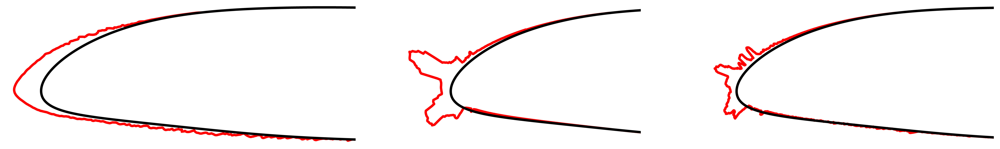
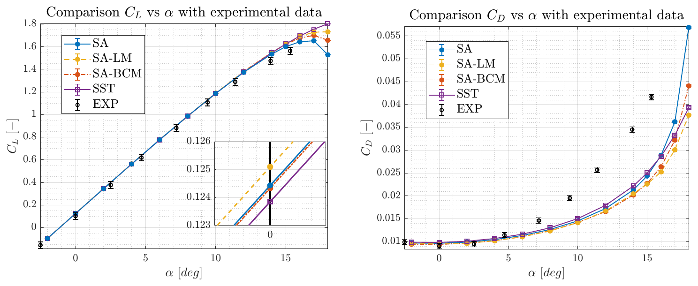
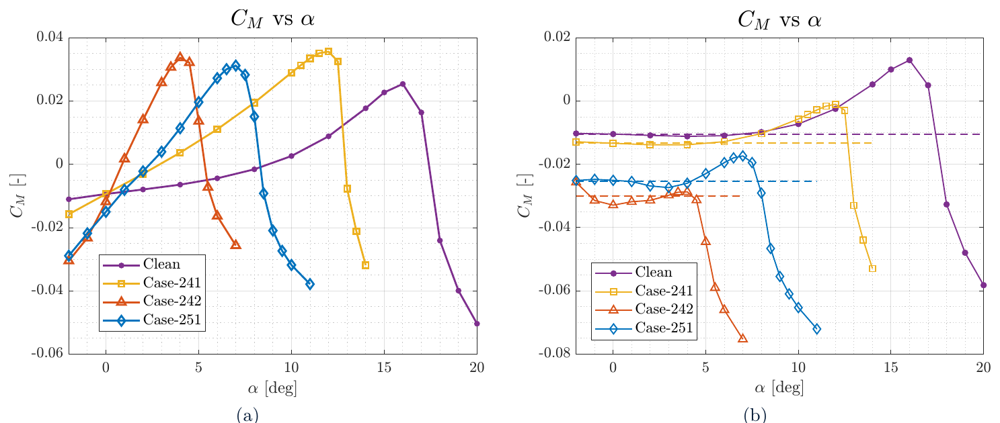
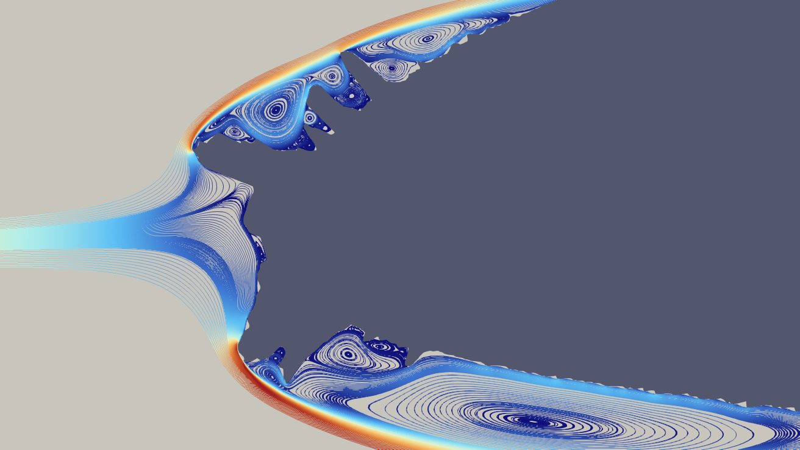

## The problem: ice accretion on airfoil

This project investigates the aerodynamic consequences of **ice accretion** on the NACA 23012 airfoil through **Computational Fluid Dynamics (CFD)** simulations. Ice formation alters the airfoil geometry, particularly at the **leading edge**, introducing complex flow phenomena that lead to a significant degradation in aerodynamic performance.

The clean airfoil is compared with three iced geometries taken from the test cases of the **1st AIAA Ice Prediction Workshop**: one **rime ice** shape (Case-241) and two **glaze ice** shapes with leading-edge horns (Case-242 and Case-251). The work was carried out with Giorgia Pallara, Federico Poleni, Alberto Vacca and Giacomo Visconti.

**Figure 1:** Comparison of the investigated iced geometries: **Case-241** (left), **Case-242** (center), and **Case-251** (right). These configurations represent different ice accretion regimes with increasing geometric complexity.  
**Image Credit:** Marco Zappoli

The study focuses on quantifying variations in **lift**, **drag**, and **pitching moment** across the iced configurations, and on how much the answer depends on the turbulence model.

## Methodology

### Flow model

The analysis was performed using **steady, two-dimensional, compressible RANS simulations** with the **SU2** solver, at the freestream conditions of the workshop's Case-241: $M = 0.325$, $Re = 3.8 \times 10^6$, $T_\infty = 250$ K. Since $M > 0.3$, the compressible equations were retained.

Two turbulence models were compared:

- **Spalart–Allmaras (SA)**, with the rotation correction for flows with strong streamline curvature
- **$k-\omega$ SST**

The sensitivity to laminar–turbulent transition was tested by coupling SA with the two transition models available in SU2, **BCM** and **Langtry–Menter**. Convective fluxes use the JST scheme, preferred over Roe because it converged on the iced geometries, with implicit Euler pseudo-time stepping and an adaptive CFL number.

### Mesh

A circular domain with a **hybrid mesh** was used: structured layers in the boundary layer with $y^+ \approx 1$ and unstructured triangles elsewhere. The inner and outer far-field distances (60 and 240 chords) were fixed by independence studies on the clean airfoil.

Gmsh's built-in boundary-layer extrusion fails on the jagged ice surfaces, so the final grids were built in **Pointwise** with its **T-Rex** anisotropic extrusion. The grids range from about 170,000 cells for the clean airfoil to 860,000 for Case-251.

") ")

**Figure 2:** Mesh generation for complex iced geometries. (a) Boundary layer resolution using the **T-Rex anisotropic extrusion** algorithm. (b) Detailed view highlighting mesh quality in regions of strong geometric irregularity.  
**Image Credit:** Marco Zappoli

In parallel, a **MATLAB script** was written that generates the Gmsh geometry file directly, with transfinite boundary-layer blocks, triangles where offset points converge and fans where they spread. It produces a clean mesh around the Case-251 ice without manual fixes, and gives the same drag polar as the Pointwise grid, with small differences in lift only near stall.

 Gmsh built-in")  MATLAB + Gmsh")

**Figure 3:** Boundary-layer cells at an ice irregularity: (a) with Gmsh's built-in extrusion, (b) with the MATLAB-generated geometry.  
**Image Credit:** CFD project report

### Verification and validation

A three-grid convergence study with Richardson extrapolation gave grid convergence indices well below 0.1 % for $C_L$ and $C_D$ on the clean airfoil. On the iced airfoils small mesh changes make the results oscillate, so asymptotic convergence could not be shown, a known difficulty of icing simulations; Case-251 was run on a further refined grid.

For the clean airfoil, the lift curve agrees with the wind-tunnel data of Harris (1939) within the experimental uncertainty over the whole linear range. Drag was not used for validation because the experimental uncertainty was too large.

**Figure 4:** Clean NACA 23012: lift and drag against the wind-tunnel data of Harris (1939), for all the turbulence and transition models.  
**Image Credit:** CFD project report

## Results

### Clean airfoil: turbulence models diverge after stall

All models agree up to about $\alpha = 10^\circ$. SA predicts $C_{L,max}$ at $\alpha = 15^\circ$ and a sharp stall, while $k-\omega$ SST predicts a gentler drop, because it predicts a much smaller separation bubble.

 SA")  k–ω SST")

**Figure 5:** Separation on the clean airfoil at $\alpha = 18^\circ$, normalized velocity magnitude: (a) Spalart–Allmaras, (b) $k-\omega$ SST.  
**Image Credit:** CFD project report

### Iced airfoils

Ice accretion leads to a **substantial degradation of aerodynamic performance**, with severity strongly dependent on ice morphology. Values below are from the standard SA model:

- **Rime ice (Case-241):** moderate impact, mainly a longer effective chord with a wavy surface that creates small near-wall recirculation zones. Stall angle reduced from $\approx 15^\circ$ to just under $12^\circ$.
- **Glaze ice (Case-242, Case-251):** severe degradation due to **horn-shaped leading-edge formations**:
  - stall below $5^\circ$ for Case-242 and at $7^\circ$ for Case-251
  - a clear reduction of the lift slope and an increase in **drag**
  - early onset of **large-scale separation**, where the leading-edge and trailing-edge separation zones merge

Case-242 is worse than Case-251 even though its ice looks simpler: the secondary horns of Case-251, further downstream, partly hold back the growth of the leading-edge separation.

On the iced airfoils, **SA with and without transition models gives practically the same results**: the ice forces transition right at the leading edge, so a transition model has nothing left to predict.

**Surface roughness**, modelled for Case-241 with an equivalent sand-grain height on the iced region, raises both drag components, with **skin friction about 30 % higher** at all angles of attack.

") ")

**Figure 6:** (a) Lift curves for all configurations using the SA turbulence model. (b) Decomposition of drag into **pressure** ($C_{D,P}$) and **skin-friction** ($C_{D,SFC}$) components for Case-241, with and without surface roughness.  
**Image credit:** Marco Zappoli

### Pitching moment and aerodynamic centre

The ice also moves the **aerodynamic centre forward**, from about 24 % of the chord for the clean airfoil to 22 % (Case-241), 18 % (Case-251) and 10 % (Case-242), and makes the moment coefficient about it more negative.

**Figure 7:** Pitching moment of all airfoils about the quarter chord (left) and about the aerodynamic centre of each geometry (right), SA model.  
**Image Credit:** CFD project report

**Figure 8:** Streamlines at the leading edge of Case-251 (SA, $\alpha = 0^\circ$): the ice protrusions create cavity flows and several recirculation zones.  
**Image Credit:** Marco Zappoli

> [!TIP] Key takeaways
> - **Ice accretion alters boundary layer physics**, promoting early separation and forced transition.
> - **Glaze ice** produces the most critical degradation due to strong geometric discontinuities.
> - The **aerodynamic centre shifts toward the leading edge**, changing the pitching moment and the longitudinal stability, a likely factor in degraded handling in icing conditions.
> - **Turbulence modelling choices** strongly influence predictions in separated flow, much more than on the clean airfoil.
> - With limited resources, an open-source mesher such as Gmsh can do the job if the boundary layer is scripted.

> [!WARNING] Limits of the model
> These are steady 2D RANS results. Post-stall behaviour, where separation zones merge and convergence slows down, would need unsteady simulations, and grid independence could not be fully demonstrated on the iced geometries.
