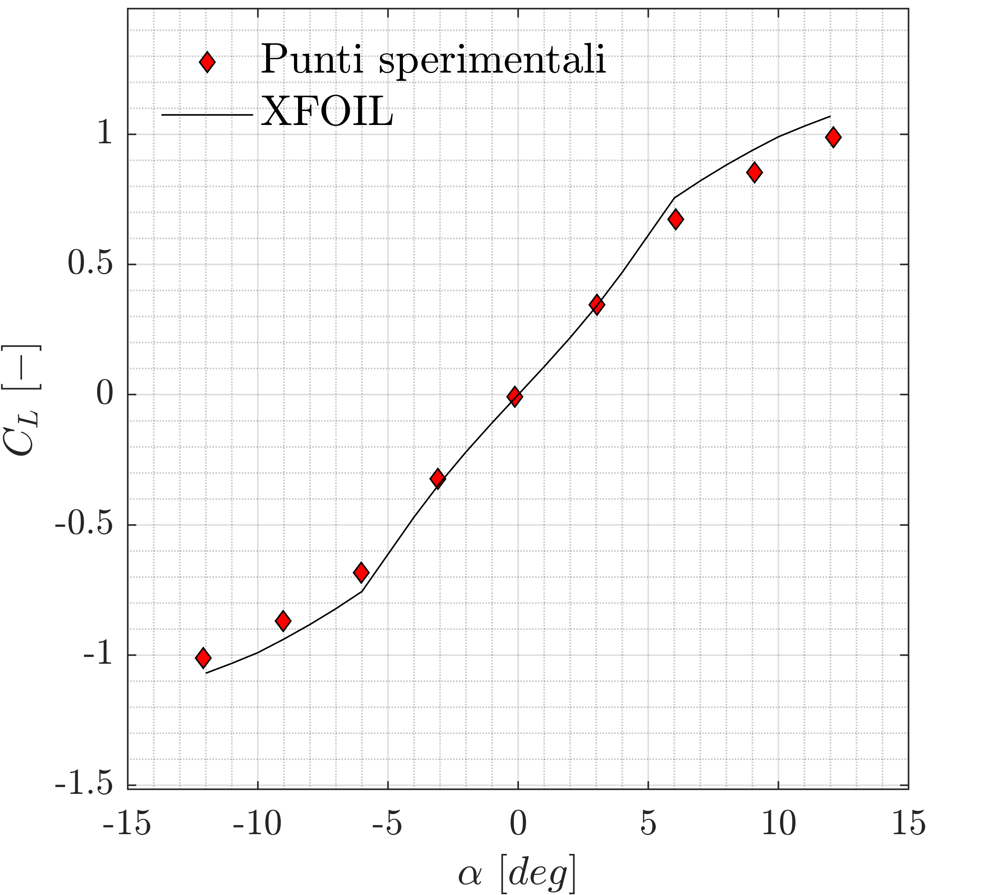
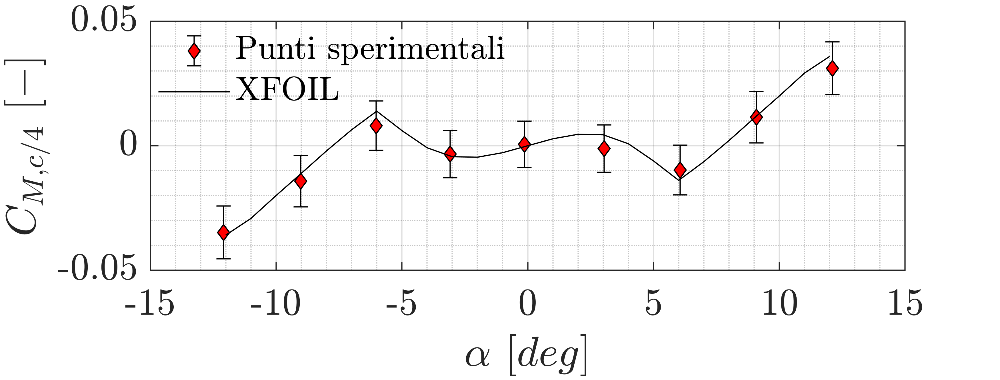
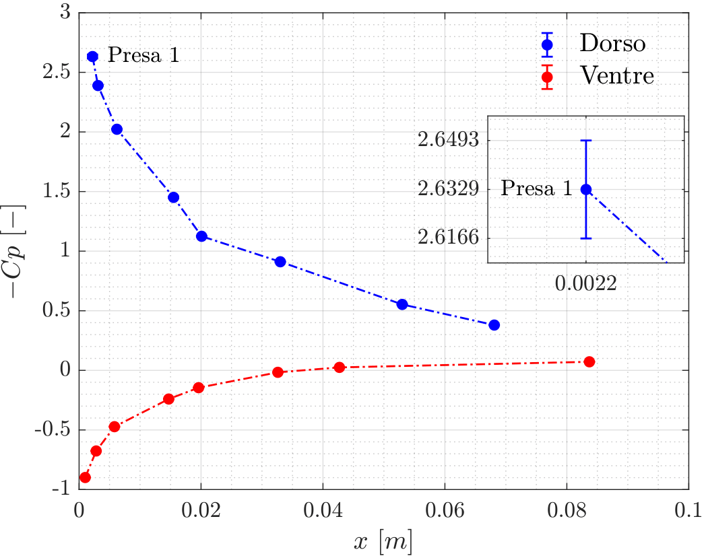
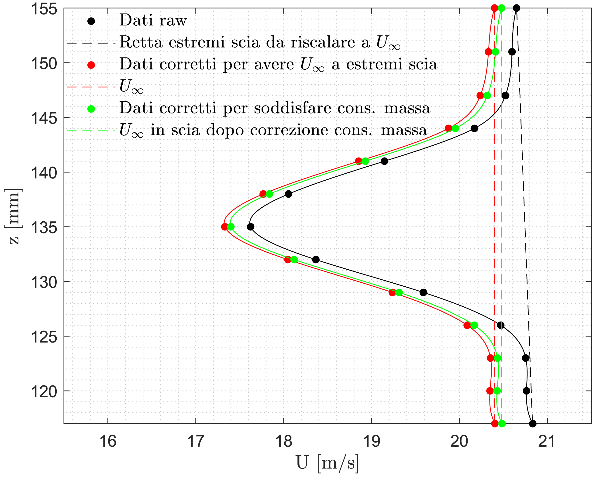
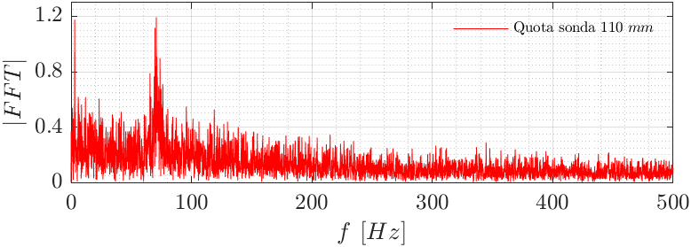
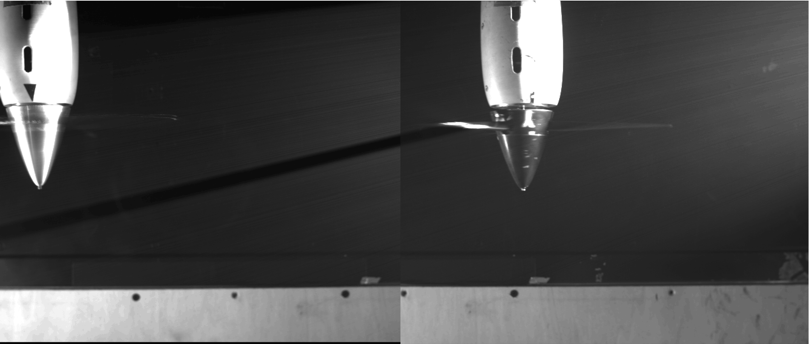
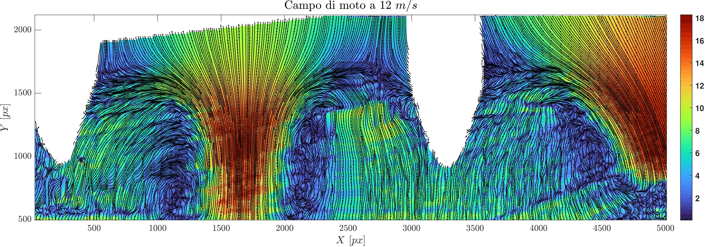

## Wind Tunnel Laboratory Experiments

This series of laboratory activities focuses on the **experimental characterization of aerodynamic flows**, combining **force measurements**, **pressure and velocity diagnostics**, and **advanced flow visualization techniques**.

The objective is to bridge the gap between theoretical aerodynamics and practice, emphasizing **measurement techniques**, **data processing**, and **physical interpretation**.

### Note

The technical reports are currently available in **Italian**, as required by the original coursework. An **English version** may be provided in the future.

## Lab 1 – Force Measurements

This experiment focuses on the measurement of **aerodynamic forces and moments** acting on an airfoil model using a **strain-gauge balance system**.

The goal is to determine the **lift**, **drag**, and **pitching moment coefficients**, and to assess their agreement with theoretical predictions.

**Methodology:**

- **Calibration** of the balance using known loads to obtain the calibration matrix
- **Decoupling** of force and moment components from sensor signals
- Measurements across a range of **angles of attack**
- Application of corrections (e.g., **blockage**, **buoyancy**)
- Computation of aerodynamic coefficients ($C_L$, $C_D$, $C_M$)

 

**Figure 1:** Left: calibration process of the **strain-gauge balance**. Right: comparison between experimental measurements and **XFOIL predictions** for lift (top) and pitching moment (bottom).  
**Image Credit:** Marco Zappoli

The results show good agreement in the linear regime, while deviations at higher incidence highlight the role of **viscous effects and flow separation**.

[View or download the full technical report (PDF) for Lab 1](/pdf/Lab_1_Poleni_Vacca_Visconti_Zappoli.pdf)

## Lab 2 – Pressure & Hot-Wire Measurements

This experiment investigates the development of the **pressure coefficient** and the **wake structure** behind a lifting surface using pressure probes and hot-wire anemometry.

The objective is to relate **pressure distribution**, **velocity fields**, and **turbulence characteristics** to aerodynamic performance.

**Methodology:**

- Measurement of **static** and **total pressure** to reconstruct velocity distributions
- Evaluation of **pressure coefficient** profiles along the flow
- Hot-wire measurements of **wake velocity deficit**
- **Statistical** and **spectral analysis** of turbulent fluctuations

 

**Figure 2:** Top: pressure coefficient distribution at $\alpha=6^\circ$ (left) and wake velocity profile at $\alpha=8^\circ$ (right). Bottom: spectral content of velocity fluctuations (FFT) at $\alpha=25^\circ$.  
**Image Credit:** Marco Zappoli

The results highlight the link between **wake development**, **momentum deficit**, and **turbulent fluctuations**, providing insight into the mechanisms governing aerodynamic drag.

[View or download the full technical report (PDF) for Lab 2](/pdf/Lab_2_Poleni_Vacca_Visconti_Zappoli.pdf)

## Lab 3 – Particle Image Velocimetry (PIV)

This activity focuses on the development of a **MATLAB-based algorithm** for processing **PIV measurements**, applied to the analysis of the flow generated by two side-by-side rotors in vortex ring state conditions.

The goal is to reconstruct the **velocity field** and identify coherent flow structures through advanced image processing techniques.

**Methodology:**

- **Calibration** to determine spatial resolution (px/mm)
- Pre-processing: **alignment**, **masking**, **background correction**
- Cross-correlation analysis:
  - standard spatial correlation
  - **FFT-based correlation** for improved computational efficiency
- **Subpixel interpolation** (Gaussian fitting)
- Post-processing:
  - **outlier detection** (median test)
  - interpolation of missing vectors

 

**Figure 3:** Top: mean background image. Bottom: reconstructed velocity field at 12 m/s obtained using the **FFT-based correlation algorithm**.  
**Image Credit:** Marco Zappoli

The analysis enables the identification of **coherent vortical structures** and provides a high-resolution description of the flow field.

[View or download the full technical report (PDF) for Lab 3](/pdf/Lab_3_Poleni_Vacca_Visconti_Zappoli.pdf)
