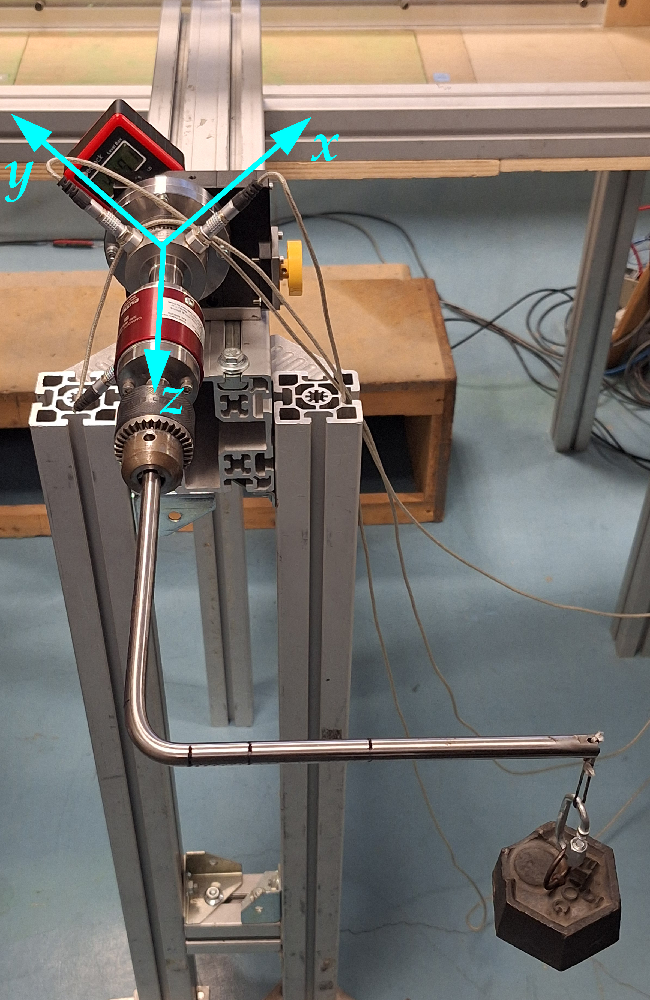

Three laboratory campaigns from the Experimental Fluid Dynamics course at Politecnico di Milano, each built around one measurement technique: what it measures, how the setup is calibrated, and how the raw signals become aerodynamic quantities. All the data processing was written in MATLAB.

## Lab 1: force measurements

A NACA 0015 wing section ($c = 100$ mm) spans the 300 × 450 mm test section of a closed-circuit wind tunnel and is mounted on a two-axis load cell and a torque cell.

- **Calibration** of the balance with known loads, giving the matrix that separates lift, drag and moment from the cell voltages
- **Corrections** for solid and wake blockage and for horizontal buoyancy
- $C_L$, $C_D$ and $C_M$ over a sweep of angles of attack, compared with **XFOIL** at $Re = 1.6 \times 10^5$

") ")

**Figure 1:** Top: calibration of the **strain-gauge balance**. Bottom: (a) lift and (b) pitching moment against **XFOIL**.  
**Image Credit:** Marco Zappoli

Lift agrees well in the linear range. Drag is the hardest quantity to measure with a balance and carries the largest uncertainty, partly from small oscillations of the model during the test.

## Lab 2: pressure and hot-wire measurements

A NACA 23012 section with wall pressure taps, and a hot-wire probe traversed through the wake.

- $C_p$ distribution and the lift and pressure drag obtained by integrating it
- **Drag from the wake velocity deficit**, potentially more accurate than the balance of Lab 1
- **Spectral analysis** of the hot-wire signal: at $\alpha = 25^\circ$ the wing sheds vortices like a bluff body at $f \approx 71$ Hz, i.e. a Strouhal number of **0.15**, consistent with the literature

") ") ")

**Figure 2:** (a) Pressure coefficient at $\alpha = 6^\circ$. (b) Wake velocity profile at $\alpha = 8^\circ$. (c) Spectrum of the wake velocity fluctuations at $\alpha = 25^\circ$, with the shedding peak.  
**Image Credit:** Marco Zappoli

## Lab 3: particle image velocimetry

Two side-by-side 30 cm rotors, a 1:5 model of the propulsion on an eVTOL half-wing, run at 7000 rpm against the oncoming flow to reproduce the **vortex ring state** of a vertical descent, at 10 and 12 m/s.

We wrote our own **PIV processing code** in MATLAB:

- calibration (px/mm), image alignment, masking and background removal
- cross-correlation of interrogation windows, computed both directly and with the **FFT**, which gives the same result about **23 times faster**
- Gaussian three-point **sub-pixel** peak fit, median-test outlier removal and interpolation of the missing vectors

") ")

**Figure 3:** (a) Mean background of the image pairs. (b) Mean velocity field at 12 m/s from the FFT-based correlation.  
**Image Credit:** Marco Zappoli

The mean field shows the toroidal vortices expected in vortex ring state and matches the result of PIVlab. Uneven laser illumination limited the quality of derived quantities such as vorticity.

> [!TIP] Key takeaways
> - Each technique has its own weak spot: a balance gives all forces but noisy drag, pressure taps give $C_p$ but only at discrete points, and the wake survey gives the best drag.
> - The hot-wire resolves unsteady flow and captured vortex shedding at a Strouhal number close to literature values.
> - A home-made PIV code reproduces a commercial tool once calibration and pre-processing are done carefully.
