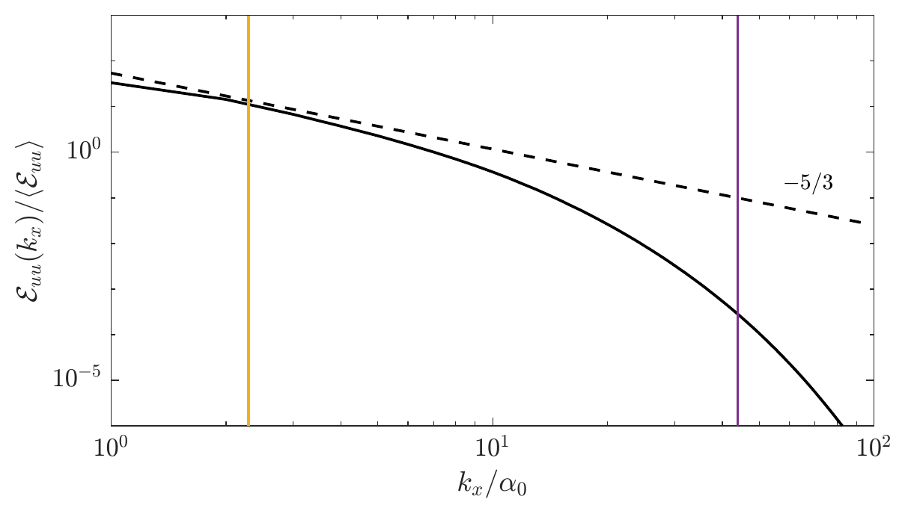
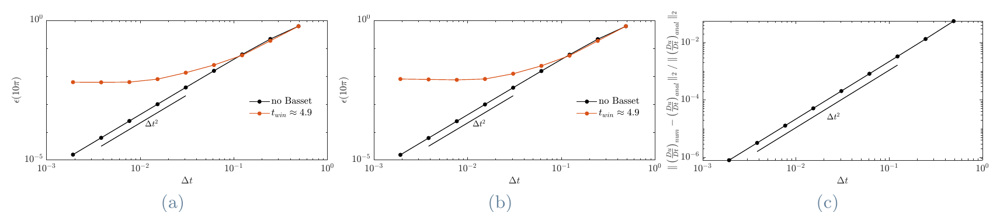

## The problem: inertial particles in turbulence

Unlike passive Lagrangian tracers, **inertial particles** do not exactly follow the carrier flow. Instead of remaining uniformly distributed, they spontaneously form **clusters and voids**, giving rise to highly intermittent concentration fields.

This phenomenon, known as **preferential concentration**, plays a central role in:

- **cloud microphysics** (droplet growth and collision rates)
- **astrophysical processes** (dust aggregation)
- **reactive flows** (mixing and combustion efficiency)

Understanding *where particles accumulate*, and more importantly *why*, remains a fundamental challenge in turbulence research.

### Why homogeneous shear turbulence?

Most of what we know about clustering comes from **homogeneous isotropic turbulence**, which is statistically simple but rarely found in practice. Real flows have mean shear, and wall-bounded flows add walls, inhomogeneity and turbophoresis on top of it, which makes the effect of shear alone hard to isolate.

**Homogeneous shear turbulence (HST)** keeps a uniform mean shear while staying spatially homogeneous and free of walls. It is the cleanest setting to ask how shear-induced anisotropy changes particle dynamics. Previous particle-laden HST studies used a reduced form of the Maxey–Riley–Gatignol equation without the **Basset history force**, even though recent work in isotropic turbulence shows that it can matter for particles close to the Kolmogorov scale.

### Objectives

1. Quantify the relative weight of each force in the Maxey–Riley–Gatignol equation in an anisotropic flow, and identify when reduced models remain adequate.
2. Assess how the Basset history force affects small-scale clustering and its anisotropy.
3. Characterise the geometry and topology of clusters with Voronoï tessellation.
4. Relate where particles accumulate to the flow topology they sample, within the centrifugal and sweep–stick frameworks.

**Figure 1:** Instantaneous flow field visualization. Coherent structures are identified using the **$Q$-criterion**, while particles (dark orange) highlight preferential accumulation within **strain-dominated regions**.  
**Image Credit:** Marco Zappoli

### Physical mechanisms

Particle clustering is not random, but emerges from well-defined mechanisms driven by the interaction between **particle inertia** and **turbulent flow structures**.

Inertial particles tend to:

- be expelled from vortical regions (**centrifugal mechanism**)
- accumulate in **strain-dominated regions**
- preferentially sample regions of low acceleration (**sweep–stick mechanism**)

These processes generate dynamically evolving, elongated coherent structures. In the presence of **mean shear**, particle distributions become **anisotropic**, exhibiting preferred orientations aligned with the underlying flow.

## Methodology

The analysis is based on **Direct Numerical Simulations (DNS)** of **homogeneous shear turbulence**, resolving all relevant flow scales without turbulence modeling assumptions.

Particle dynamics are described using a one-way coupled point-particle approach based on the **Maxey–Riley–Gatignol (MRG) equation**.

A key feature of this work is the inclusion of the **Basset history force**, which accounts for unsteady viscous diffusion in the particle boundary layer. This introduces a **memory effect**, making particle dynamics intrinsically **non-local in time**.

### Carrier flow

The flow is solved with a modified version of the channel-flow DNS code of [Luchini & Quadrio (2006)](https://doi.org/10.1016/j.jcp.2005.06.003), in the non-shearing formulation of [Sekimoto *et al.* (2016)](https://doi.org/10.1063/1.4942496):

- Fourier expansions in the two homogeneous directions and fourth-order compact finite differences in the shear direction, with pseudo-spectral nonlinear terms de-aliased by the 3/2 rule
- **shear-periodic** boundary conditions in the vertical direction, enforced in spectral space
- the L32 box of Sekimoto *et al.*, with a Taylor-scale Reynolds number $Re_\lambda \approx 48$ and a Corrsin shear parameter $S^* \approx 7$
- grid spacing below the Kolmogorov scale in every direction ($\Delta/\eta \approx 0.5$–$1$), so the dissipative range is fully resolved

**Figure 2:** One-dimensional spectrum of the streamwise velocity. The yellow line marks the Corrsin shear scale and the purple line the Kolmogorov scale: shear dominates the largest scales, and a short inertial range sits between the two.  
**Image Credit:** Marco Zappoli, MSc thesis

### Particles

- six populations of $5 \times 10^5$ particles each, with Stokes numbers $St \approx 0.1$, $0.5$ and $1$ and density ratios $\rho_p/\rho_f = 10$ and $100$
- fluid velocity, gradient and Laplacian interpolated at the particle position with sixth-order Lagrangian interpolation, on MPI panels aligned with the domain decomposition
- particles crossing the shear-periodic boundary are remapped with the Lees–Edwards procedure, with a matching correction of the streamwise velocity
- semi-implicit time integration of the particle velocity and second-order Adams–Bashforth for the position
- Basset history force evaluated with the window–tail method of [Van Hinsberg *et al.* (2011)](https://doi.org/10.1016/j.jcp.2010.11.014): an exact window over the last few steps plus a sum of exponentials for the tail, so the memory cost does not grow with time

Denoting by $\tau_p = 2\rho_p r_p^2/(9\rho_f\nu)$ the particle response time, where $\rho_p$ and $\rho_f$ are the particle and fluid densities, respectively, $r_p$ is the particle radius, $\boldsymbol{u}_p$ is the particle velocity, and $\boldsymbol{u}$ is the undisturbed fluid velocity evaluated at the particle position, the governing equation for particle motion reads:

$$
\begin{equation*}
\begin{split}
\frac{d\boldsymbol{u}_p}{dt} &= \underbrace{\frac{1}{\tau_p} \left( \boldsymbol{u}-\boldsymbol{u}_p + \frac{r_p^2}{6} \nabla^2\boldsymbol{u} \right)}_{\textit{Stokes drag}} + \underbrace{\frac{\rho_f}{2\rho_p} \left( 3\frac{D\boldsymbol{u}}{Dt} - \frac{d\boldsymbol{u}_p}{dt} + \frac{r_p^2}{10} \frac{d}{dt}\left(\nabla^2\boldsymbol{u}\right) \right)}_{\textit{Pressure gradient and added mass}} \\[3pt]
&+ \underbrace{\frac{1}{\tau_p}\frac{r_p}{\sqrt{\pi\nu}} \int_{-\infty}^t K_B(t-\tau) \frac{d}{d\tau} \left( \boldsymbol{u}-\boldsymbol{u}_p + \frac{r_p^2}{6} \nabla^2\boldsymbol{u} \right) d\tau}_{\textit{Basset history force}},
\end{split}
\end{equation*}
$$

The parameter space is explored by varying the particle **Stokes number** $St$ and the particle-to-fluid **density ratio** $\rho_p/\rho_f$, with emphasis on how inertia and memory effects influence clustering and force balance.

### Verification

Each term of the particle solver was checked against analytical solutions before production runs, including a sedimenting particle with the full history force and a particle on a circular trajectory in a steady, space-dependent flow.

**Figure 3:** Circular-trajectory test. Errors in (a) particle position, (b) particle velocity and (c) material derivative $D\boldsymbol{u}/Dt$ against the time step. Without the history force the scheme converges at second order; with the window–tail Basset term the error levels off where the exponential kernel fit dominates.  
**Image Credit:** Marco Zappoli, MSc thesis

## Results

### Force balance

The relative contribution of forces strongly depends on particle properties. In particular, the role of the **Basset history force** increases with particle size and is in first approximation non dependent on the density ratio.

**Figure 4:** Probability density functions of the normalized directional contributions $\Pi_i = (\boldsymbol{a}_i \cdot \boldsymbol{a}_p)/|\boldsymbol{a}_p|^2$ for a selected Stokes number and two different density ratio. Insets highlight the tails of the distributions.  
**Image Credit:** Marco Zappoli

### Spatial distribution and clustering

Particle organization is primarily governed by the **Stokes number**, which sets the response time to turbulent fluctuations.

 

**Figure 5:** Instantaneous particle distributions (white dots) in the $x$–$z$ plane, overlaid on the magnitude of the vorticity component normal to the plane (lighter regions indicate higher vorticity). Increasing $St$ leads from near-homogeneous dispersion to pronounced clustering and segregation.  
**Image Credit:** Marco Zappoli

At low $St$, particles closely follow the flow and remain nearly homogeneous. At $St=\mathcal{O}(1)$, inertia induces strong deviations, leading to pronounced clustering.

Cluster topology exhibits a remarkable degree of **universality**, consistent across different flow configurations.

") ") ")

**Figure 6:** (a) Example of a coherent particle cluster with its principal axes. Probability density functions of normalized (b) **asphericity** and (c) **acylindricity**, quantifying cluster shape.  
**Image Credit:** Marco Zappoli

> [!TIP] Key takeaways
> Clustering in turbulent shear flows is a **robust and highly structured phenomenon**, emerging from the interplay between **turbulence**, **particle inertia**, and **memory effects**.
>
> Particle distributions exhibit **organized, anisotropic, and scale-dependent patterns** that critically influence transport, mixing, and collision processes.

> [!NOTE] Computational scope
> This work relies on extensive **High-Performance Computing (HPC)** resources. Only a subset of the methodology and representative results are presented here.

> [!WARNING] Copyright & publication status
> The full method and results of this work are in the [MSc thesis (PDF)](/pdf/MSc_Thesis_Marco_Zappoli.pdf). A follow-up article, extending the study to neutrally buoyant particles, a wider range of Stokes numbers and companion simulations without the history force, has been submitted to the *Journal of Fluid Mechanics* ([publication entry](/publications/#zappoli2026clustering)). The material presented here is intended for **qualitative illustration only**; quantitative values and parameters have been partially omitted or modified.  
> **Copyright © Marco Zappoli. All rights reserved.**
