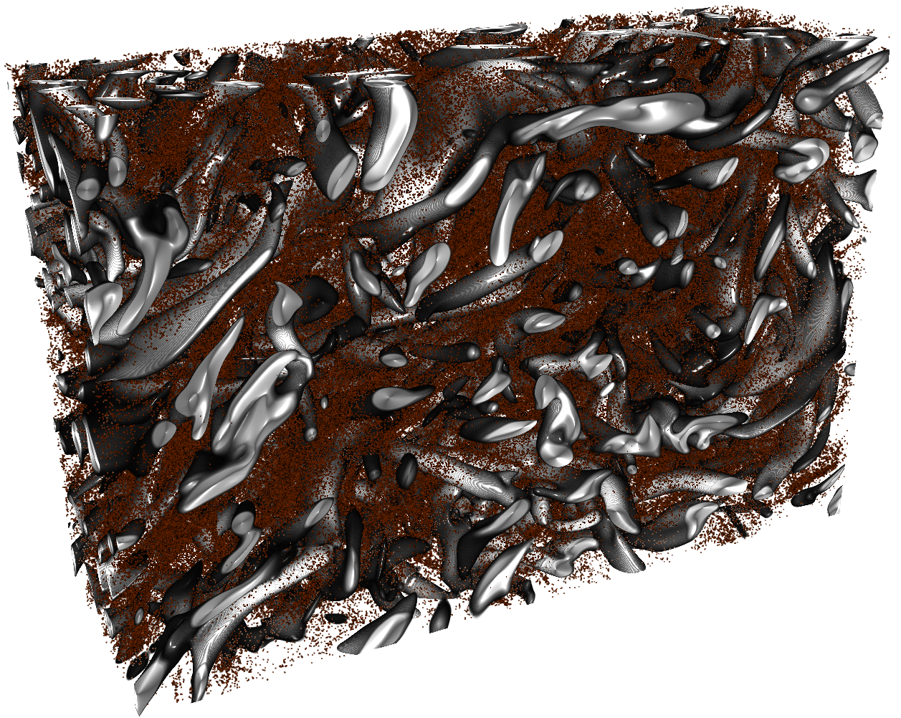
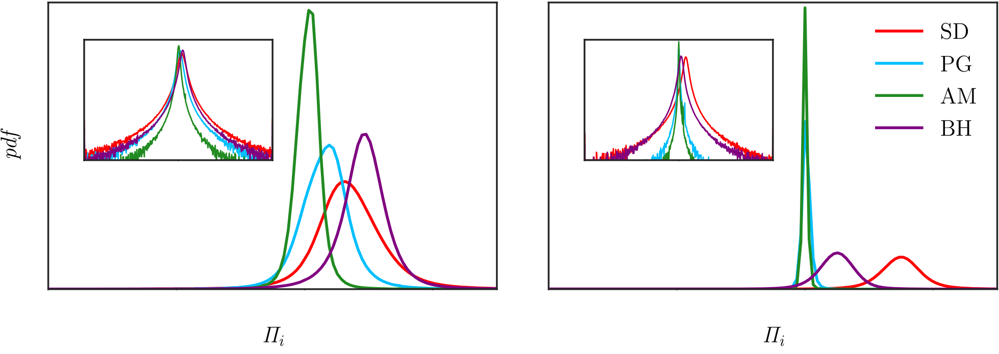
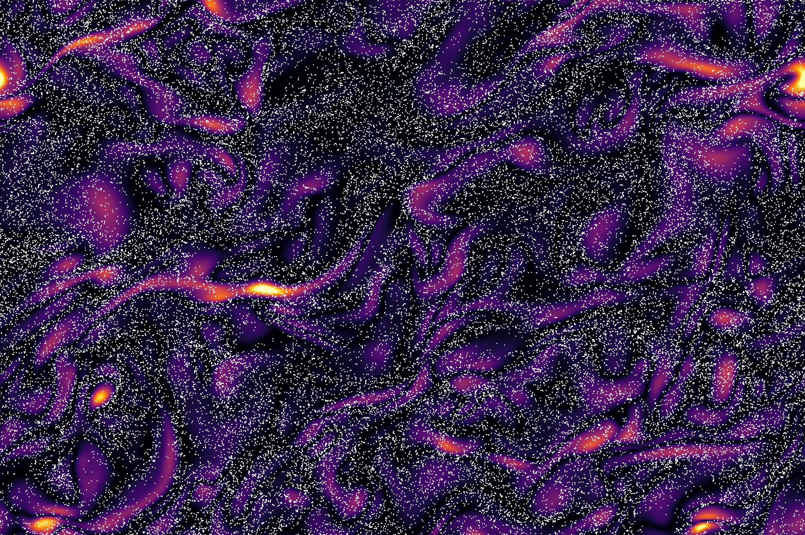
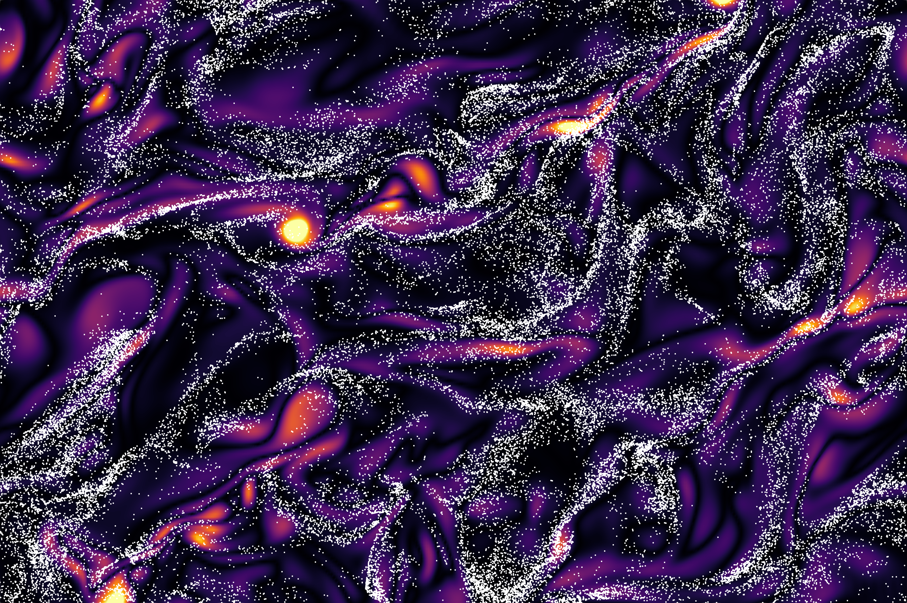
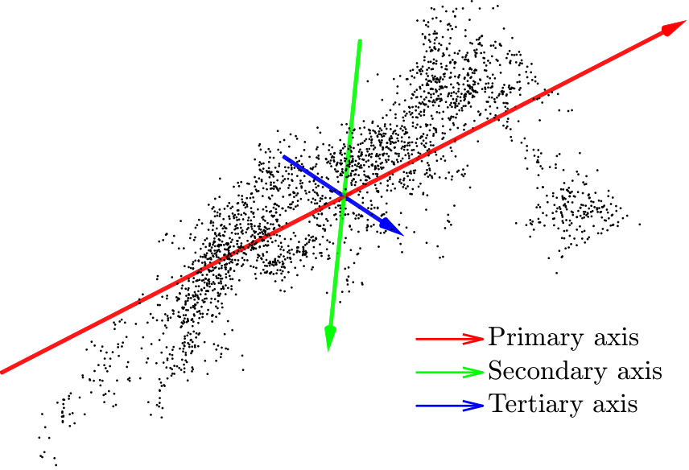
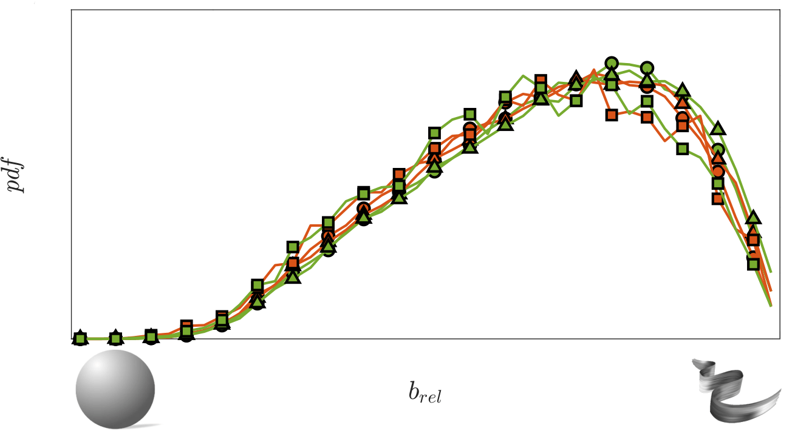
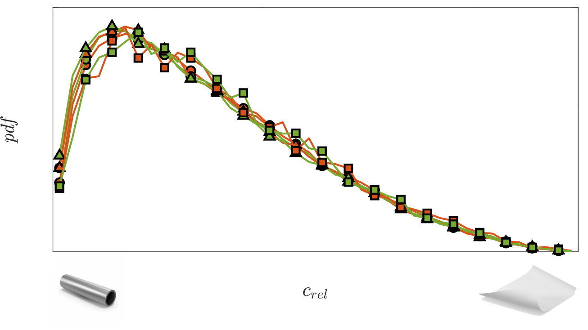

## The problem: inertial particles in turbulence

Unlike passive Lagrangian tracers, **inertial particles** do not exactly follow the carrier flow. Instead of remaining uniformly distributed, they spontaneously form **clusters and voids**, giving rise to highly intermittent concentration fields.

This phenomenon, known as **preferential concentration**, plays a central role in:

- **cloud microphysics** (droplet growth and collision rates)
- **astrophysical processes** (dust aggregation)
- **reactive flows** (mixing and combustion efficiency)

Understanding *where particles accumulate*, and more importantly *why*, remains a fundamental challenge in turbulence research.

**Figure 1:** Instantaneous flow field visualization. Coherent structures are identified using the **$Q$-criterion**, while particles (dark orange) highlight preferential accumulation within **strain-dominated regions**.  
**Image Credit:** Marco Zappoli

### Physical mechanisms

Particle clustering is not random, but emerges from well-defined mechanisms driven by the interaction between **particle inertia** and **turbulent flow structures**.

Inertial particles tend to:

- be expelled from vortical regions (**centrifugal mechanism**)
- accumulate in **strain-dominated regions**
- preferentially sample regions of low acceleration (**sweep–stick mechanism**)

These processes generate dynamically evolving, elongated coherent structures. In the presence of **mean shear**, particle distributions become **anisotropic**, exhibiting preferred orientations aligned with the underlying flow.

## Methodology

The analysis is based on **Direct Numerical Simulations (DNS)** of **homogeneous shear turbulence**, resolving all relevant flow scales without turbulence modeling assumptions.

Particle dynamics are described using a one-way coupled point-particle approach based on the **Maxey–Riley–Gatignol (MRG) equation**.

A key feature of this work is the inclusion of the **Basset history force**, which accounts for unsteady viscous diffusion in the particle boundary layer. This introduces a **memory effect**, making particle dynamics intrinsically **non-local in time**.

The numerical implementation follows:

- [Sekimoto *et al.* (2016)](https://doi.org/10.1063/1.4942496) for the DNS reference frame
- [Van Hinsberg *et al.* (2011)](https://doi.org/10.1016/j.jcp.2010.11.014) for efficient evaluation of the Basset term

Denoting by $\tau_p = 2\rho_p r_p^2/(9\rho_f\nu)$ the particle response time, where $\rho_p$ and $\rho_f$ are the particle and fluid densities, respectively, $r_p$ is the particle radius, $\boldsymbol{u}_p$ is the particle velocity, and $\boldsymbol{u}$ is the undisturbed fluid velocity evaluated at the particle position, the governing equation for particle motion reads:

$$
\begin{equation*}
\begin{split}
\frac{d\boldsymbol{u}_p}{dt} &= \underbrace{\frac{1}{\tau_p} \left( \boldsymbol{u}-\boldsymbol{u}_p + \frac{r_p^2}{6} \nabla^2\boldsymbol{u} \right)}_{\textit{Stokes drag}} + \underbrace{\frac{\rho_f}{2\rho_p} \left( 3\frac{D\boldsymbol{u}}{Dt} - \frac{d\boldsymbol{u}_p}{dt} + \frac{r_p^2}{10} \frac{d}{dt}\left(\nabla^2\boldsymbol{u}\right) \right)}_{\textit{Pressure gradient and added mass}} \\[3pt]
&+ \underbrace{\frac{1}{\tau_p}\frac{r_p}{\sqrt{\pi\nu}} \int_{-\infty}^t K_B(t-\tau) \frac{d}{d\tau} \left( \boldsymbol{u}-\boldsymbol{u}_p + \frac{r_p^2}{6} \nabla^2\boldsymbol{u} \right) d\tau}_{\textit{Basset history force}},
\end{split}
\end{equation*}
$$

The parameter space is explored by varying the particle **Stokes number** $St$ and the particle-to-fluid **density ratio** $\rho_p/\rho_f$, with emphasis on how inertia and memory effects influence clustering and force balance.

## Results

### Force balance

The relative contribution of forces strongly depends on particle properties. In particular, the role of the **Basset history force** increases with particle size and is in first approximation non dependent on the density ratio.

**Figure 2:** Probability density functions of the normalized directional contributions $\Pi_i = (\boldsymbol{a}_i \cdot \boldsymbol{a}_p)/|\boldsymbol{a}_p|^2$ for a selected Stokes number and two different density ratio. Insets highlight the tails of the distributions.  
**Image Credit:** Marco Zappoli

### Spatial distribution and clustering

Particle organization is primarily governed by the **Stokes number**, which sets the response time to turbulent fluctuations.

 

**Figure 3:** Instantaneous particle distributions (white dots) in the $x$–$z$ plane, overlaid on the magnitude of the vorticity component normal to the plane (lighter regions indicate higher vorticity). Increasing $St$ leads from near-homogeneous dispersion to pronounced clustering and segregation.  
**Image Credit:** Marco Zappoli

At low $St$, particles closely follow the flow and remain nearly homogeneous. At $St=\mathcal{O}(1)$, inertia induces strong deviations, leading to pronounced clustering.

Cluster topology exhibits a remarkable degree of **universality**, consistent across different flow configurations.

 

**Figure 4:** Left: example of a coherent particle cluster with principal axes. Right: probability density functions of normalized **asphericity** and **acylindricity**, quantifying cluster shape.  
**Image Credit:** Marco Zappoli

## Key Takeaways

Clustering in turbulent shear flows is a **robust and highly structured phenomenon**, emerging from the interplay between **turbulence**, **particle inertia**, and **memory effects**.

Particle distributions exhibit **organized, anisotropic, and scale-dependent patterns** that critically influence transport, mixing, and collision processes.

### Computational Scope

This work relies on extensive **High-Performance Computing (HPC)** resources. Only a subset of the methodology and representative results are presented here.

### Copyright & Publication Status

The simulations and results are part of an ongoing manuscript under preparation for the *Journal of Fluid Mechanics (JFM)*. The material presented here is intended for **qualitative illustration only**; quantitative values and parameters have been partially omitted or modified.  
**Copyright © Marco Zappoli. All rights reserved.**
